# Digital Library Management System

A modern Spring Boot application for managing a digital library. The system supports book management, user reservations, GitHub login authentication, and utilizes Redis caching for enhanced performance.

## Technologies Used

* **Spring Boot 3**
* **Thymeleaf** (template engine)
* **Spring Security** with **OAuth2 GitHub login**
* **Spring Data JPA** with **MySQL**
* **Redis Cache**
* **Bootstrap 5** for UI styling
* **Docker & Docker Compose**

## Features

* Login with GitHub (OAuth2)
* Role-based access: Admin / User
* Book CRUD operations (Admin only)
* View books with pagination and search (by title, author, or ISBN)
* Reserve books if copies are available (User only)
* Cancel reservations
* Dynamic book availability (copies increase/decrease with reservation status)
* Session-based access control

---
## Live Demo Status

  
 **Live demo is currently unavailable** due to hosting limitations.  
 You can still run the project locally using Docker Compose.

---

## Getting Started (Local Setup)

### 1 Clone the repository
```bash
git clone https://github.com/ahmadkadri978/Digital-Library-Management-System.git
cd Digital-Library-Management-System
```

### 2 Build and run with Docker Compose
No need to install MySQL or Redis manually. Just run:
```bash
./mvnw clean package -DskipTests
docker compose up --build
```

This will start:
- **MySQL** (database: `library`, user: `appuser`, password: `apppass`)
- **Redis** (port 6379)
- **Spring Boot app** at [http://localhost:8080](http://localhost:8080)

### 3 Configure GitHub OAuth2
1. Register an app at [GitHub Developer Settings](https://github.com/settings/developers)  
2. Set the **Authorization callback URL** to:
   ```
   http://localhost:8080/login/oauth2/code/github
   ```
3. Put your `client-id` and `client-secret` in `application.properties`.

---

## Screenshots

Here are some UI snapshots of the Digital Library Management System:

### Home Page
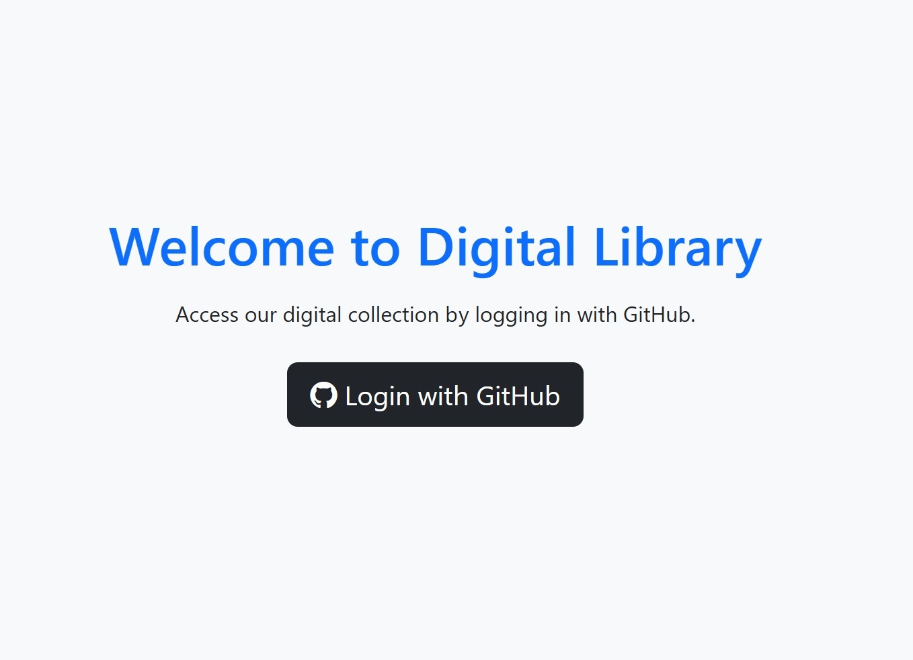

### Books List Page (User)
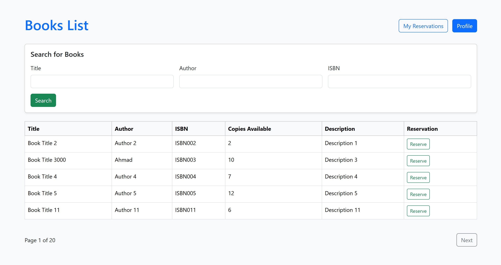

### Profile Page (OAuth GitHub Login)
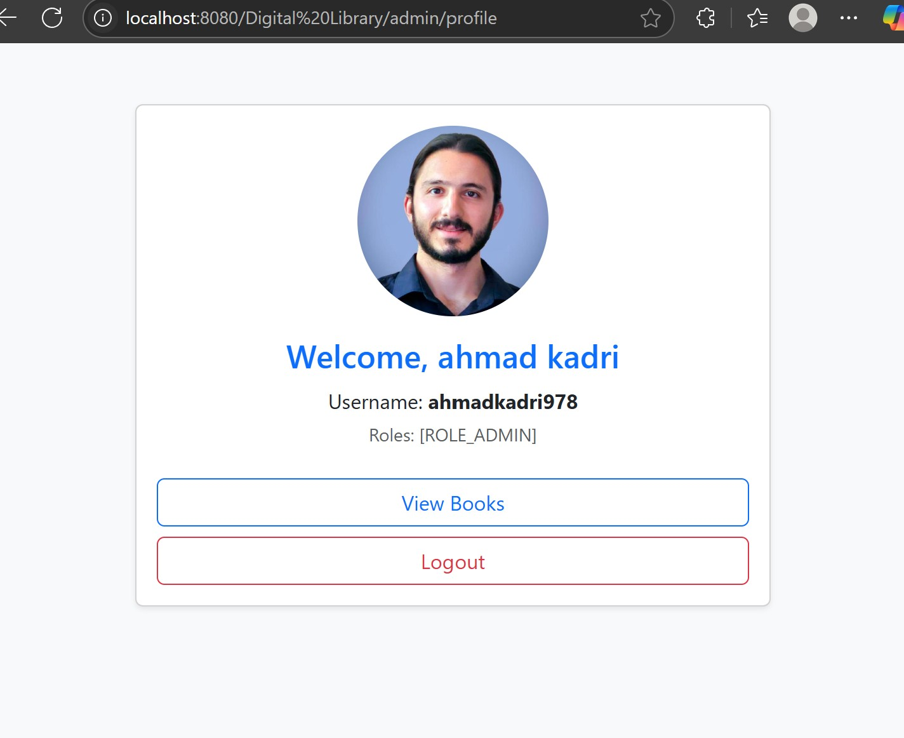

### Search Books
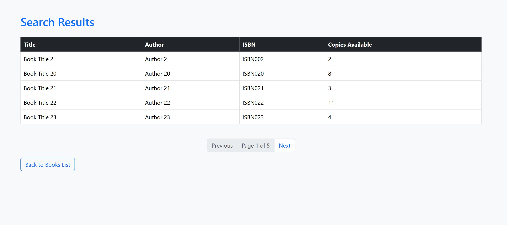

### My Reservations (User)
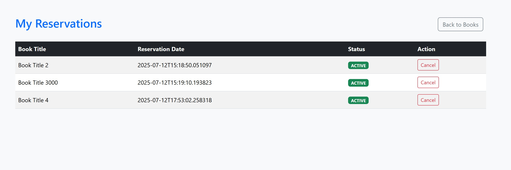

### Duplicated Reservations 
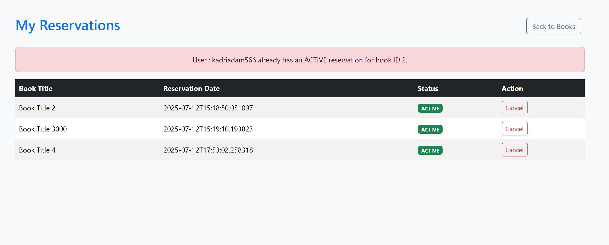

### Reservations (Admin)
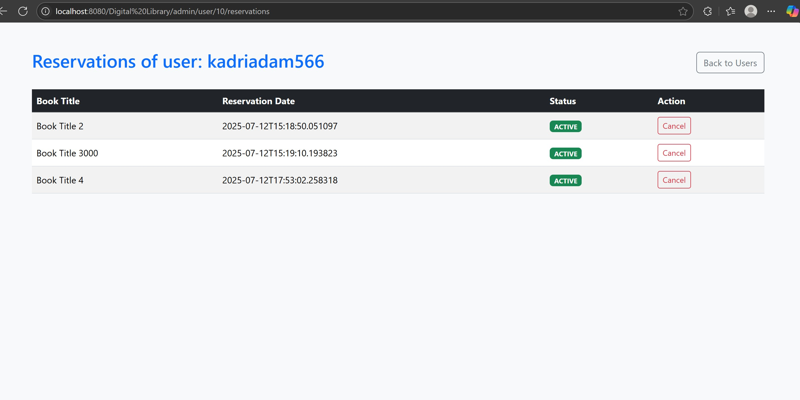

### Admin - View All Books
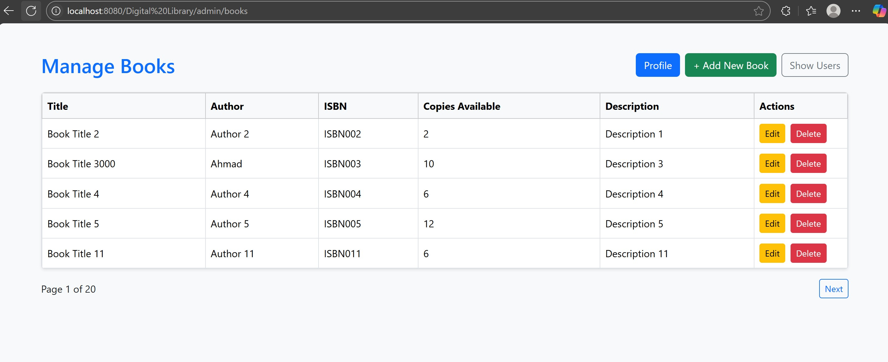

### Admin - Add Book
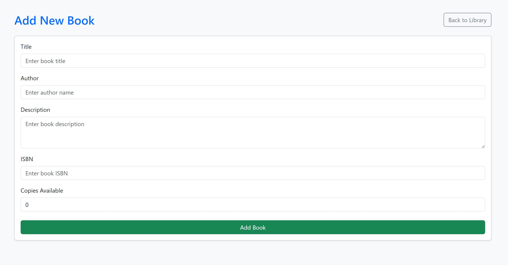

### Admin - Edit Book
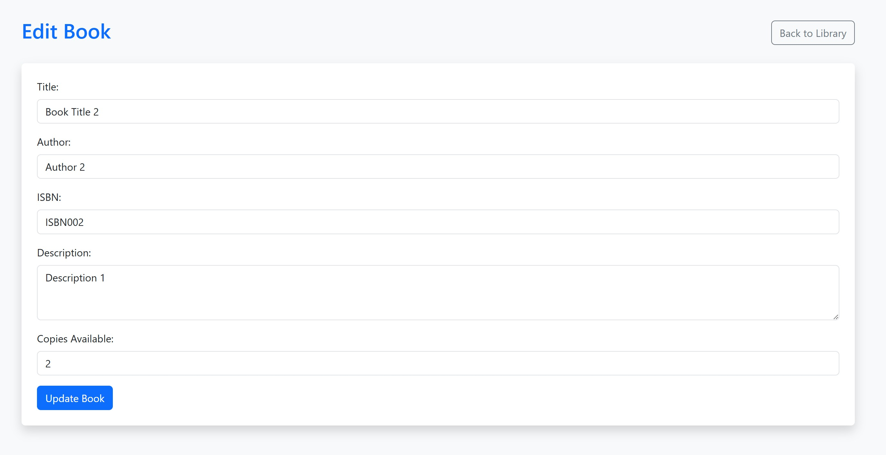

### Admin - Manage Users
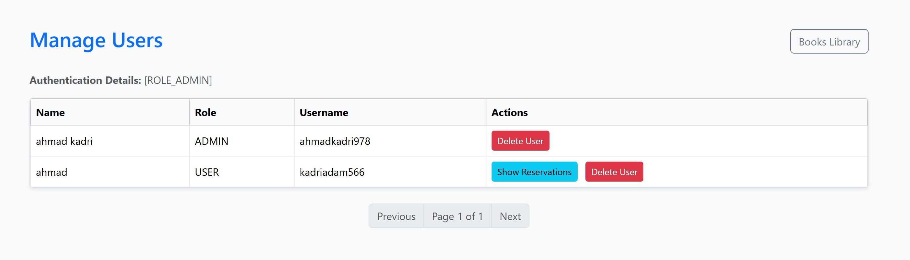

### Admin - Manage Reservations


---
## Example `application.properties` (Local)
```properties
spring.datasource.url=jdbc:mysql://mysql:3306/library
spring.datasource.username=appuser
spring.datasource.password=apppass

spring.data.redis.host=redis
spring.data.redis.port=6379
spring.cache.type=redis

spring.jpa.hibernate.ddl-auto=update
spring.jpa.show-sql=true

spring.security.oauth2.client.registration.github.client-id=your_client_id
spring.security.oauth2.client.registration.github.client-secret=your_client_secret
spring.security.oauth2.client.registration.github.redirect-uri=http://localhost:8080/login/oauth2/code/github
spring.security.oauth2.client.registration.github.scope=user:email
```

---

## Notes

* All cache-related services are annotated with `@Cacheable` and `@CacheEvict`
* Role-based visibility and access are handled using Spring Security
* All user data is managed based on GitHub OAuth profile
* Thymeleaf templates adjust UI based on user role (Admin/User)

---

 [Visit my portfolio](https://ahmadkadri978.github.io/portfolio)
